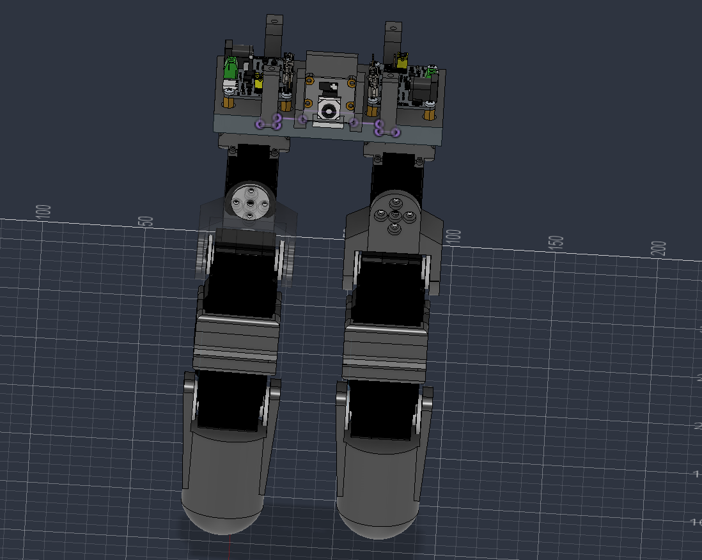
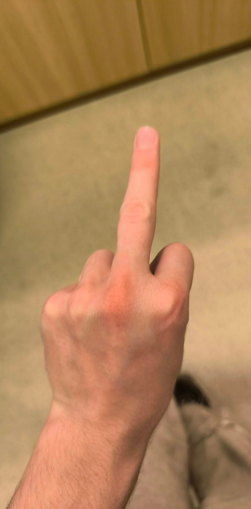
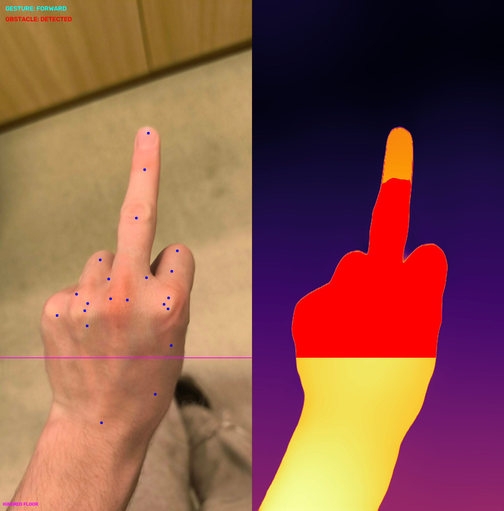

# Humanoid Legs — Zurich Hackathon

A humanoid legs project built around **Raspberry Pi 5**, **ROS 2**, and camera-based hand gesture recognition. The operator raises a specific number of fingers, and the system translates the gesture into a robot movement command.

The goal is to execute commands while maintaining balance and a stable gait. This repository contains the vision module, a ROS 2 command publisher, an obstacle detection experiment, and mechanical part files. Motor control and stabilization require separate integration; their implementation is not currently included in this repository.

## Robot CAD model



*CAD model of the humanoid legs and their mechanical assembly.*

## How it works

```text
Camera → OpenCV + MediaPipe → Flask API /status → ROS 2 node
                                                    ↓
                                              /camera/goal
                                                    ↓
                                     Leg control and stabilization
                                         (separate robot module)
```

1. The camera supplies frames to `Soft/camera/main.py`.
2. MediaPipe detects hand landmarks. The program counts raised fingers and selects a command.
3. A Flask server provides a video stream and the current command as JSON.
4. `robot_controller.py` reads the API state and publishes commands to the other robot modules through ROS 2.

## Control gestures



*Example gesture: one raised finger corresponds to the `FORWARD` command.*

Four fingers are counted: index, middle, ring, and little finger. **The thumb is ignored.** If multiple hands are detected, the program uses the first hand returned by the detector.

| Raised fingers | Command | Action |
| --- | --- | --- |
| 0 | `STOP` | Stop |
| 1 | `FORWARD` | Move forward |
| 2 | `BACKWARD` | Move backward |
| 3 | `LEFT` | Move left |
| 4 | `RIGHT` | Move right |
| No hand detected | `NO_FINGERS` | Stop |

Recognition uses the vertical positions of finger landmarks in the image. Hold your hand upright, clearly visible, and in good lighting.

## Repository structure

```text
.
├── CAD/
│   └── gcode/                  # .3mf files for 3D-printed leg parts
├── Soft/
│   └── camera/
│       ├── main.py             # Camera, gesture recognition, and Flask API
│       ├── robot_controller.py # ROS 2 command publisher
│       └── ImageTest.py        # Gesture and depth estimation experiment
├── TestPhotos/                 # Images for recognition tests
└── README.md
```

`CAD/gcode/` contains files for the `foot`, `flat_foot`, `knee`, and `thigh` parts.

## Requirements

- Raspberry Pi 5 running Linux with ROS 2 configured.
- 6 × ST3215 servos for leg actuation.
- 2 × ESP32-based drivers for the ST3215 servos.
- Raspberry Pi Camera Module 3. The current code expects the camera to be accessible to OpenCV at device index `0` (usually `/dev/video0`).
- Python 3 with OpenCV, NumPy, MediaPipe, and Flask.
- ROS 2 packages: `rclpy` and `std_msgs`.
- Internet access on the first run to download the MediaPipe model.

The repository does not pin operating system, ROS 2, or library versions. The environment must provide MediaPipe compatibility with the Python version and Raspberry Pi architecture, as well as access to the Python packages supplied by ROS 2.

## Getting started

Run the following commands from the repository root. These instructions assume ROS 2 is already installed.

### 1. Prepare the environment

Load your ROS 2 environment, replacing `<distro>` with your distribution name:

```bash
source /opt/ros/<distro>/setup.bash
python3 -m venv --system-site-packages .venv
source .venv/bin/activate
python -m pip install opencv-python numpy mediapipe flask
```

### 2. Start the camera and API

```bash
cd Soft/camera
python main.py
```

On the first run, the program automatically downloads `hand_landmarker.task` into the current directory.

The server listens on port `5000`:

- Camera stream: `http://<RASPBERRY_PI_IP>:5000/`
- Current state: `http://<RASPBERRY_PI_IP>:5000/status`

Example `/status` response:

```json
{
  "command": "FORWARD",
  "obstacle_detected": false
}
```

### 3. Start the ROS 2 node

In a second terminal, load the same environment from the repository root:

```bash
source /opt/ros/<distro>/setup.bash
source .venv/bin/activate
python Soft/camera/robot_controller.py
```

By default, the node reads the API at `http://127.0.0.1:5000/status`, so both programs should run on the same device. If they run on separate devices, update `VISION_API_URL` in `robot_controller.py`.

### 4. Verify communication

In a terminal with the ROS 2 environment loaded:

```bash
ros2 topic echo /camera/goal
```

Show different gestures to the camera and observe the published values. Running these two programs provides gesture recognition and command publishing; physical movement requires a subscriber that controls the motors.

## ROS 2 command format

The `robot_controller_node` node publishes `std_msgs/msg/Int8MultiArray` messages on the `camera/goal` topic (resolved to `/camera/goal` by default). Its timer interval is `0.05 s`, targeting 20 Hz; the actual rate also depends on API response time.

Array element order:

```text
[forward, backward, left, right, stop]
```

| Command | Value |
| --- | --- |
| `FORWARD` | `[1, 0, 0, 0, 0]` |
| `BACKWARD` | `[0, 1, 0, 0, 0]` |
| `LEFT` | `[0, 0, 1, 0, 0]` |
| `RIGHT` | `[0, 0, 0, 1, 0]` |
| `STOP`, `NO_FINGERS`, or an obstacle detected | `[0, 0, 0, 0, 1]` |

## Experiments and current limitations



*Example experimental output: hand landmarks and the recognized gesture on the left; estimated depth and obstacle regions on the right.*

`Soft/camera/ImageTest.py` tests still images using the `Intel/dpt-hybrid-midas` model for depth estimation and experimental obstacle detection. It additionally requires `requests`, `Pillow`, `transformers`, a runtime capable of running the model, and a Google Colab display utility. Its image URLs point to the remote repository root; update them to match the actual image locations under `TestPhotos/` before testing.

In the current live camera program, `main.py`, `obstacle_detected` is always set to `false`. The experimental obstacle detection has not yet been integrated into live processing.

If the API connection fails, the ROS 2 node logs a warning but does not automatically publish a STOP command. The command subscriber should handle communication loss and stop the robot after a configured timeout without a new message. Perform initial movement tests with the structure supported and a way to disconnect the motors.
